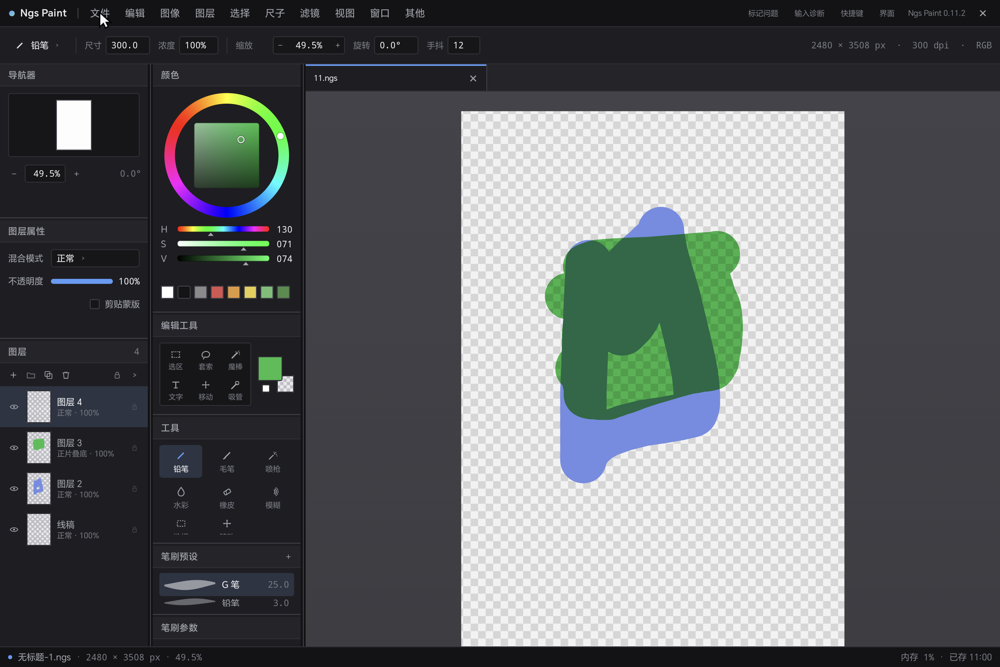
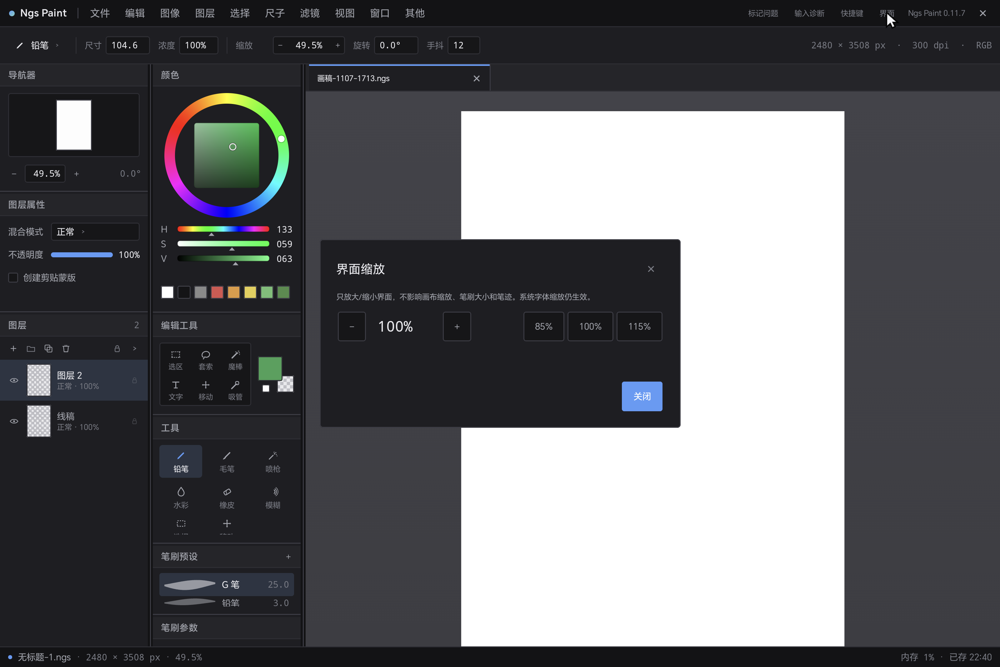

# Ngs Paint

> 面向 Android 平板 + 数位笔的原生绘画应用，目标是复刻 SAI2 那套桌面绘画手感：
> 压感笔迹、图层、快捷键、面板化工作区。

**当前版本：0.11.9** · 开发中 · 横屏 · Android 8.0+

> 📌 本仓库只做**项目展示**（截图、功能、更新说明）。
> 项目仍在开发中，**暂不提供安装包，源代码暂不公开**。

---

## 截图

*完整工作区：菜单栏 / 工具选项栏 / 左右侧栏 / 画布标签页 / 状态栏；左侧图层面板正在演示剪贴蒙版。*

*界面缩放 85%–115%：只放大缩小界面，不影响画布缩放、笔刷大小和笔迹。*

---

## 项目定位

- **原生 Android**：Kotlin + Jetpack Compose 负责界面，高频绘画路径走原生 `View` + `Canvas`。
- **为笔而生**：数位笔压感、鼠标、蓝牙键盘混合输入；Space 平移、Alt+Space 旋转、中键平移、滚轮缩放。
- **桌面级工作流**：菜单栏 / 工具选项栏 / 左右侧栏 / 状态栏，面板宽度与高度均可拖拽并记忆。
- **横屏 + 三档布局**：应用锁定横屏；按窗口宽度分 Compact / Medium / Expanded，窄屏自动收起侧栏、画布优先。
- **可调界面缩放**：85%–115%（5% 步进），只改界面，不影响画布、笔刷和笔迹。
- **可诊断**：输入事件追踪、保存/生命周期日志、崩溃自动落盘并在下次启动提示。

## 主要功能

| 模块 | 能力 |
| --- | --- |
| 绘画 | 压感笔迹（铅笔 / 橡皮），文档像素语义，每种笔刷各自记尺寸 |
| 视口 | 缩放、平移、旋转、适应窗口（含迟到按键回溯修正） |
| 图层 | 新建 / 复制 / 删除 / 重命名 / 拖拽排序 / 显示隐藏 / 不透明度 / 锁定 / 5 种混合模式 / 剪贴蒙版 |
| 多文档 | 画布标签页：新建、切换、拖动排序、未保存标记，标签过多可横向滚动 |
| 历史 | 文档级撤销 / 重做，覆盖所有图层操作 |
| 合并 | 向下合并；纯「正常」模式走矢量合并，含非正常混合模式时拒绝合并（不产生错误画面） |
| 文件 | `.ngs` 保存 / 另存为 / 打开；应用内 PC 风格文件窗口；每目录手动排序；崩溃与切后台恢复点 |
| 布局 | Compact（<600dp）/ Medium（600–840dp）/ Expanded（≥840dp）；窄屏侧栏可折叠，画布优先 |
| 界面 | 界面缩放 85%–115%（5% 步进，重启保留） |
| 可靠性 | 草稿后台保存（主线程只做快照）、备份式原子替换、启动残局恢复 |
| 诊断 | 输入追踪、性能统计、崩溃报告 + 下次启动提示 |
| 快捷键 | Q 铅笔、S 橡皮、Ctrl+Z/Y、D 清空、Ctrl+R 新建、Ctrl+E 合并、Delete 删除、E 透明色，全部可改键 |

## 技术栈

- Kotlin 2.4.x（AGP 9.3.1 内置 Kotlin 编译）
- Jetpack Compose（Material3）+ 原生 `View` / `Canvas` / `Bitmap` 渲染
- minSdk 26 · targetSdk 36

## 关于安装包

项目仍在开发中，**暂不对外提供安装包**。等核心功能稳定后会在这里发布测试版。

## 开发进度

- ✅ 界面外壳 → 输入验证 → 压感绘画 → 视口 → 编辑工具栏 / 橡皮
- ✅ 图层基础、混合模式、剪贴蒙版、锁定、合并
- ✅ 保存 / 加载（`.ngs`）、文件窗口、恢复点、后台保存
- ✅ 多文档标签页、界面缩放
- ⏳ 下一步：PNG / JPEG 导出、图层文件夹、绘画工具系统（吸管 / 选区 / 套索 / 魔棒 / 移动 / 文字）

## 已知限制

- 图层文件夹尚未实现（面板按钮为占位）。
- 含非「正常」混合模式时拒绝合并。
- 栅格化合并受 `4096×4096` 像素上限约束。
- 竖屏非设计目标（锁定横屏）。
- 撤销栈不随 `.ngs` 保存。

## 关于源代码与授权

本项目为**闭源开发中**项目，本仓库**不包含源代码**，仅用于展示。
仓库不附带开源许可证，版权归作者所有：未经许可，请勿再分发、修改或用于商业用途。

## 反馈

欢迎在 [Issues](../../issues) 里提建议、报 Bug（请附上版本号、设备型号和复现步骤）。
