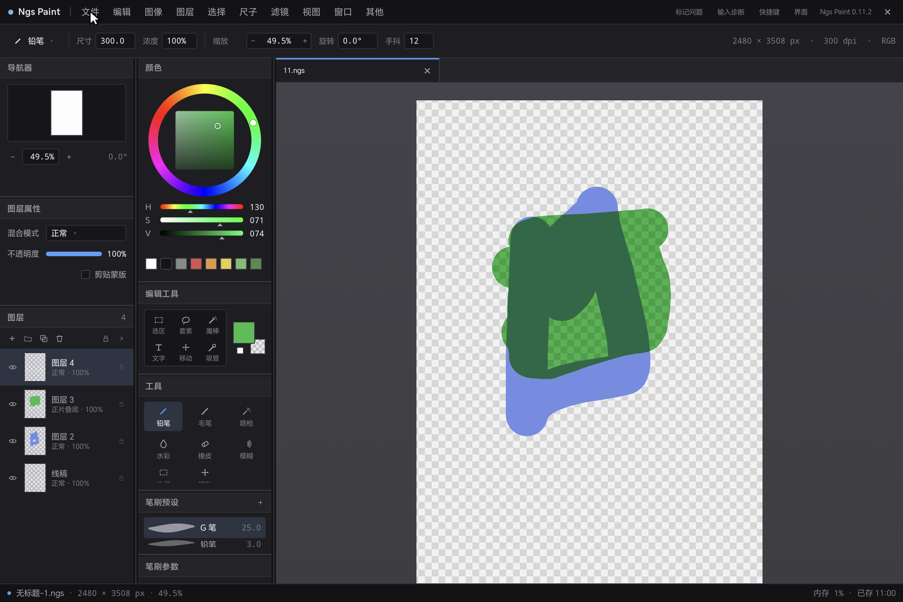
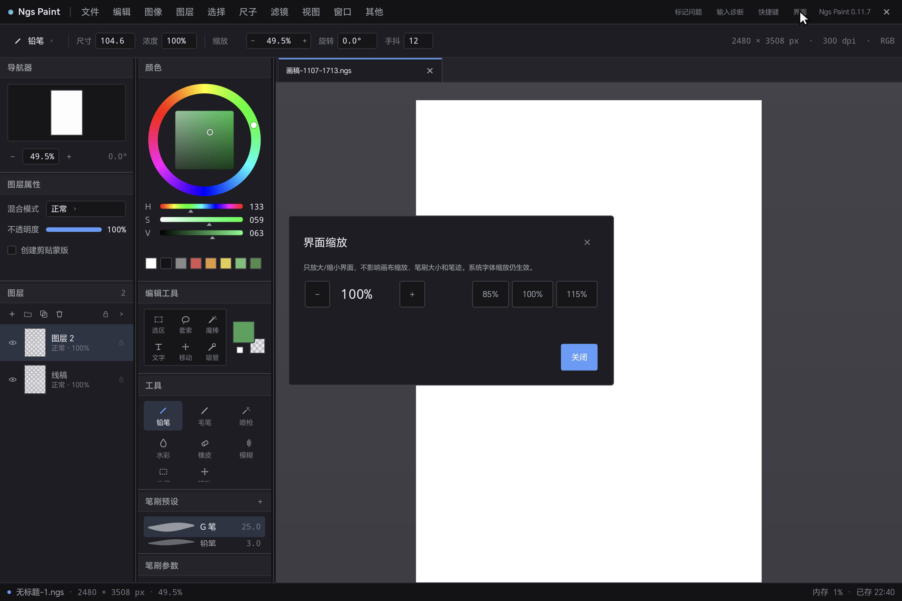

# Ngs Paint

> 面向 Android 平板 + 数位笔的原生绘画应用。压感笔迹、图层、选区、快捷键、面板化工作区，目标是接近桌面绘画软件的手感。

**当前开发版本：0.11.10（154）** · **下一次公开版本：0.11.11（155，准备中）** · Android 8.0+ · 横屏

> 本仓库只做项目展示与安装包分发，**不包含源代码**；源代码仓库私有。

---

## 截图

*完整工作区：菜单栏 / 工具选项栏 / 左右侧栏 / 画布标签页 / 状态栏；左侧图层面板正在演示剪贴蒙版。*

*界面缩放 85%–115%：只放大缩小界面，不影响画布缩放、笔刷大小和笔迹。*

---

## 下载

- **GitHub Releases**：<https://github.com/Nagisssa/ngs-paint-showcase/releases>
- **国内镜像**：Q 群文件（群号见 B 站视频简介）
- 安装包发布时会附 `SHA256SUMS.txt`；下载后可以先核对再安装。

> 0.11.11 还在做最后测试，安装包会在发布日上传；当前 Releases 还没有 APK。

### 安装

1. 下载 `NgsPaint-0.11.11.apk`；
2. 在 Android 设置里允许「安装未知来源应用」；
3. 安装后打开，无需登录、无需联网；
4. 首次启动建议横屏使用。

**要求**：Android 8.0（API 26）及以上；平板或大屏手机体验更好。

---

## 项目定位

- **原生 Android**：Kotlin + Jetpack Compose 负责界面，高频绘画路径走原生 `View` / `Canvas`。
- **为笔而生**：数位笔压感、鼠标、蓝牙键盘混合输入；Space 平移、Alt+Space 旋转、中键平移、滚轮缩放。
- **桌面级工作流**：菜单栏 / 工具选项栏 / 左右侧栏 / 状态栏，面板宽度与高度可拖拽并记忆。
- **横屏 + 三档布局**：锁定横屏；按窗口宽度分 Compact / Medium / Expanded，窄屏自动收起侧栏。
- **可调界面缩放**：85%–115%（5% 步进），只改界面，不影响画布、笔刷和笔迹。
- **本地优先**：不申请系统权限、不联网、不收集数据；文档保存在应用私有目录。

## 主要功能

| 模块 | 能力 |
| --- | --- |
| 绘画 | 压感笔迹（铅笔 / 毛笔 / 喷枪 / 水彩 / 橡皮 / 模糊）；每种笔刷各自记尺寸；最小直径、笔刷浓度、手抖平滑 |
| 取色 | 吸管：按下预览、拖动跟手、抬笔应用；只读不改文档 |
| 选区 | 套索 / 魔棒（容差可调）、蚂蚁线、`[` `]` 扩展收缩、Ctrl+F 填充、选区裁剪 |
| 变换 | Ctrl+T 自由变换：8 手柄缩放/镜像、框外拖动旋转、Enter 烘焙、Esc 还原；H 水平翻转 |
| 视口 | 缩放、平移、旋转、适应窗口 |
| 图层 | 新建/复制/删除/重命名/拖拽排序/显示隐藏/不透明度/锁定/5 种混合模式/剪贴蒙版/图层文件夹（最多 4 层嵌套）/多选拖动/Ctrl+E 压平 |
| 历史 | 文档级撤销/重做，覆盖图层操作（撤销栈暂不随文件保存） |
| 合并 | Ctrl+E 向下合并；纯「正常」模式走矢量合并，否则拒绝合并（不产生错误画面） |
| 文件 | `.ngs` 保存/另存为/打开（格式 v5，整文件 CRC32；v4 及更早文件仍可读）；应用内文件窗口；崩溃与切后台恢复点；保存/打开在后台线程 |
| 布局 | Compact / Medium / Expanded 三档；窄屏侧栏可折叠；菜单/工具栏可横向滚动 |
| 快捷键 | Q 铅笔、S 橡皮、Ctrl+Z/Y、D 清空、Ctrl+R 新建、Ctrl+E 合并、Delete 删除、E 透明色、Ctrl+F 填充、Ctrl+T 变换、H 翻转、`[` `]` 选区；全部可改键 |
| 可靠性 | 草稿后台保存、备份式原子替换、启动残局恢复、`.ngs` v5 校验和 |

## 技术栈

- Kotlin 2.4.x（AGP 9.3.1 内置 Kotlin 编译）
- Jetpack Compose（Material3）+ 原生 `View` / `Canvas` / `Bitmap` / `PorterDuff`
- minSdk 26 · targetSdk 36

## 已知限制

- 任一层使用非「正常」混合模式时拒绝合并（数学上无法等价，宁可拒绝也不改画面）。
- 双指缩放不支持（按设计只支持鼠标滚轮缩放）。
- 栅格化合并受 `4096×4096` 像素上限约束。
- 竖屏非设计目标（锁定横屏）。
- 撤销栈不随 `.ngs` 保存；打开文件后无法撤销到打开前的状态。
- PNG / JPEG 导出尚未提供，计划中。

## 隐私

**不收集任何用户数据，不联网，不申请系统权限。** 文档、恢复点、崩溃日志都保存在应用私有目录；卸载应用即删除。详见 [PRIVACY.md](PRIVACY.md)。

## 与 SAI 的关系

本项目与 SAI / SAI2 及其作者**没有任何隶属或合作关系**。仅在交互习惯上参考了桌面绘画软件，未使用其代码、图标、字体或素材。SAI、SAI2 是其各自权利人的商标。

## 许可证

自 2026-11-24 起采用 **Ngs Paint Freeware License 1.1（免费闭源）**：

- 可免费使用，包括商业绘画创作；作品版权归你。
- 不提供源代码；禁止修改、反向工程、去除版权声明。
- **允许免费、原样转发安装包**；禁止售卖、出租、嵌入其他产品再分发。
- 未来版本可能调整授权方式（包括收费）；已按本许可发布的副本仍按本许可使用。

完整条款见 [LICENSE](LICENSE)，第三方组件许可见 [THIRD-PARTY-NOTICES.md](THIRD-PARTY-NOTICES.md)。2026-11-14 至 2026-11-24 期间按 GPL-3.0 提供的副本仍适用 GPL-3.0；新版本不再适用。

## 反馈

- Bug / 建议：GitHub [Issues](https://github.com/Nagisssa/ngs-paint-showcase/issues)
- 国内：Q 群（群号见 B 站视频简介）
- 提交问题时请附：设备型号、Android 版本、应用版本、复现步骤；不要上传你不希望公开的画作。

## 更新日志

见 [CHANGELOG.md](CHANGELOG.md)。
